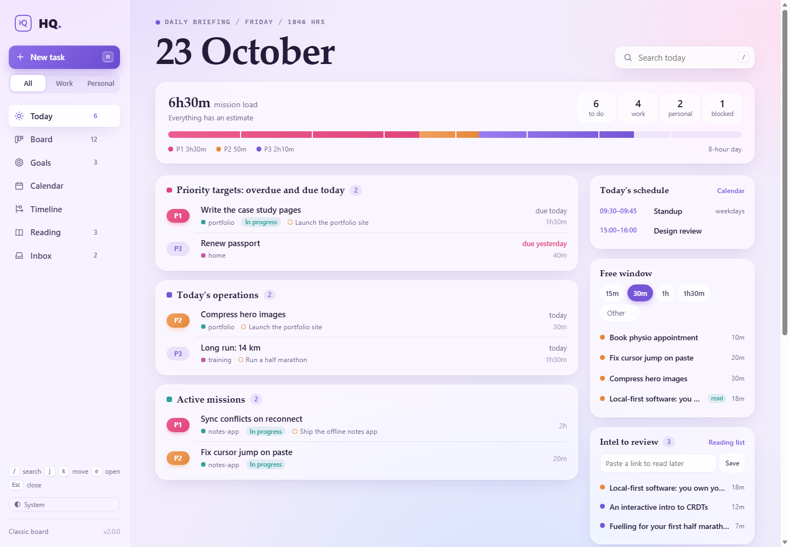
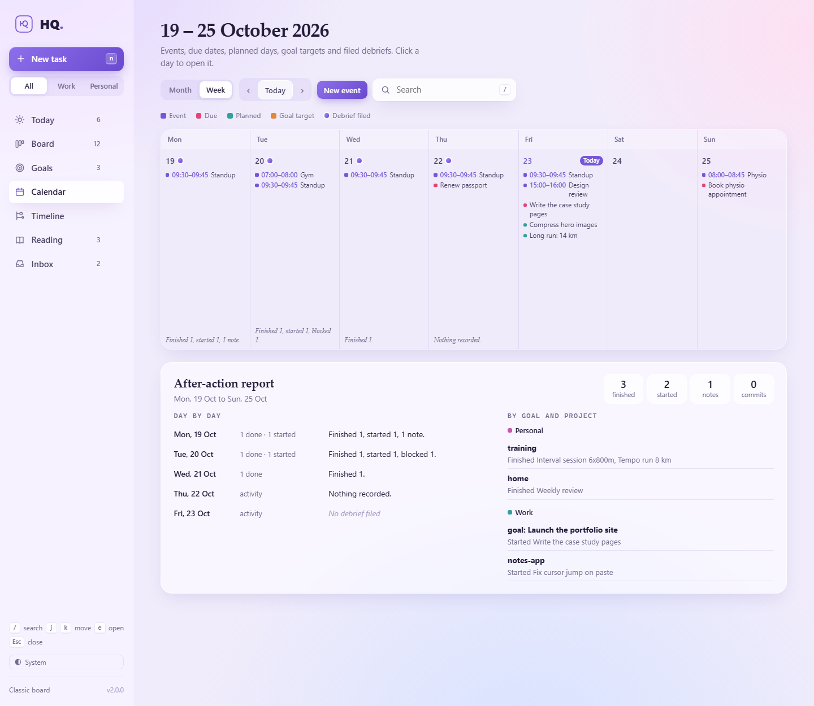
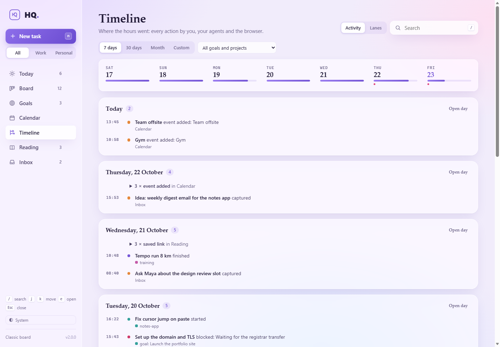
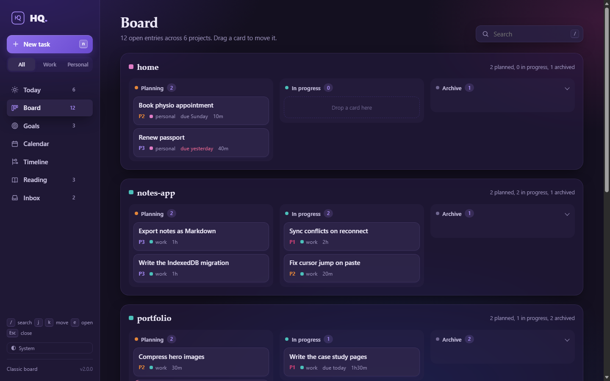
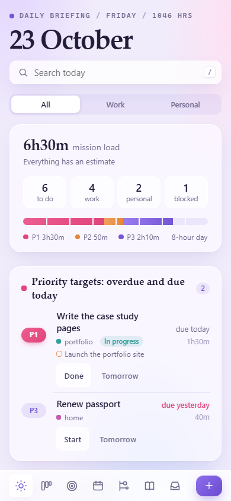
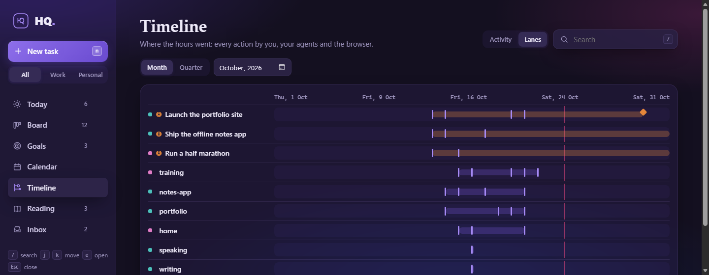

<picture>
  <source media="(prefers-color-scheme: dark)" srcset="docs/img/hq-wordmark-dark.svg">
  
</picture>

**HQ is a personal command center that lives in plain files on your own disk.**
Plan your day, track tasks and goals, keep a reading list and a calendar, and
look back at what you did, from the terminal (`hq`), a browser app, or your AI
agents. No accounts, no cloud, no dependencies: stdlib-only Python 3.10+ on
Windows, macOS and Linux.



- **A day that builds itself.** Today pulls together what's overdue or due,
  what you planned for today, goals closing this week, work in progress,
  what's blocked, today's events and the next links to read.
- **Time-aware.** Give tasks estimates and HQ shows the day's load; tell it
  "I've got 30 minutes" and it suggests what fits.
- **Goals across projects**, with target dates and progress.
- **A real record.** Every change is logged with who made it (you, an agent,
  or the browser). End the day with a debrief, then browse the calendar,
  the after-action report and the timeline.
- **Agent-first.** One line per result, `--json` on every read, real exit
  codes, no prompts, and a skill that teaches Claude Code the whole loop.
- **Yours.** Markdown files you can read, edit, grep, sync or back up however
  you like. The browser app only listens on `127.0.0.1`.

## Two modes

| | **Classic** (default) | **Advanced** |
|---|---|---|
| What it is | The original `hq` (v1): a Markdown archive with a planning → active → archive lifecycle | Everything in this README |
| Commands | `init`, `save`, `start`, `archive`, `list`, `find`, `log`, `serve` | All of those, plus priorities, dates, goals, Today, reading, inbox, calendar, days, timeline and more |
| `hq serve` | A read-only board | The HQ app, where you can make changes |
| Switch | `hq init --mode classic` | `hq init --mode advanced` |

Switching rewrites nothing in either direction, so your existing archive works
as is: missing fields get sensible defaults when they're read. Classic mode
stays byte-for-byte v1 (a regression suite guards it) and never breaks on
data advanced mode created. The original release is tagged
[`v1.0`](https://github.com/rahidmondal/hq-cli/tree/v1.0).

## Quick start

```
git clone git@github.com:rahidmondal/hq-cli.git
cd hq-cli
python hq.py init --root ~/hq-data --mode advanced
```

`hq init` creates the data folder and checks the three things that silently go
wrong, printing the exact command to fix each one:

| Check | Why it matters |
|---|---|
| `HQ_ROOT` points at your data folder | If it is unset, hq falls back to `~/.hq` and quietly writes there. |
| `hq` is on `PATH` | So the bare `hq` command works from any directory. |
| Claude Code skill installed | Optional. `hq init --install-skill` installs it (see [Agents](#agents)). |

Run the printed `[todo]` commands, open a new terminal, and run `hq init`
again until everything shows `[ok]`. It's safe to run repeatedly. Then:

```
hq save task "Write the launch post" --project site --priority P1 --due today --est 1h
hq today
hq serve          # opens the HQ app in your browser
```

Keep the data folder out of this repo; back it up or sync it however you like.

## A day with HQ

```
# Morning: what needs me?
hq today                                  # the briefing, as a table
hq set launch-post do-on tomorrow         # reshape the day with dates and priorities
hq start launch-post

# During the day
hq note launch-post "Draft done, waiting on screenshots"
hq block launch-post "Waiting on the design review"
hq dump "Ask Maya about the review slot"  # capture now, sort later
hq read https://example.com/post          # save a link; hq fetches its title and length
hq free 25m                               # what fits in a 25-minute gap?

# Evening
hq archive launch-post                    # done (or --dropped)
hq day end --summary "Good focus day"     # file the debrief to days/<date>.md
hq week                                   # look back
```

Every one of these works the same from the browser app and from an agent.

## The HQ app

In advanced mode `hq serve` opens the app at `http://127.0.0.1:8787`. It talks
like a command post (daily briefing, missions, objectives, debrief) and comes in
lavender light and dark.

- **Today:** the briefing above. Click any task to open its details: change
  priority, area, estimate, due and do-on dates, or goal; start, finish, drop,
  block or unblock it; add a note; see its activity, notes and files.
- **Board:** a kanban per project. Drag a card to start it, move it back to
  planning, or finish it (long-press first on a touch screen).
- **Goals:** each objective's progress and target date.
- **Calendar:** a month or week grid of events, due dates, planned days, goal
  targets and filed debriefs. Click a day to read its debrief, add or edit
  events, or wrap the day up. Below the grid, the **after-action report**
  shows the period's totals, each day's summary, and what was finished or
  started by goal and project.
- **Timeline:** where the hours went. *Activity* is every action by you, your
  agents and the browser, grouped by day, with a week strip and goal/project
  filter. *Lanes* draws each project and goal across the month or quarter.
- **Reading** and **Inbox:** save links and mark them read; capture thoughts
  and turn each into a task, a goal or a link.





<p>
  
  
</p>



Keys: `t` `b` `g` `c` `l` `r` `i` switch pages, `n` new task, `/` search,
`j` `k` move, `e` open, `Esc` close. The area filter (All / Work / Personal)
and the theme switch (System / Light / Dark) are in the sidebar.

Every change in the app runs the same command you'd type (`hq --by web ...`),
so validation and the log match the terminal exactly. Screenshots use made-up
demo data.

## Commands

Every command has `--help`. A `<ref>` is a slug or any unique part of one; an
ambiguous ref is an error that lists the matches, and `goal/<slug>` picks a
goal.

### Classic (and advanced)

| Command | Flags | Does |
|---|---|---|
| `hq init` | `--root PATH`, `--install-skill`, `--mode classic\|advanced` | First-time setup and checks; switches mode. |
| `hq save <kind> "<title>"` | `--project X`, `--tags a,b` | Create an entry in `planning`. `kind` is `task`, `bug`, `presentation`, `learning` or `skill`. The project is detected from the current git repo unless given; `learning` and `skill` are cross-project. |
| `hq start <slug>` | `--project X` | Move a `planning` entry to `active`. |
| `hq archive <slug>` | `--project X` | Move a `planning` or `active` entry to `archive`. |
| `hq list` | `--project X`, `--status S`, `--json` | List entries. |
| `hq find <query>` | `--json` | Search titles, tags and bodies, including learnings and skills. |
| `hq log` | `--project X`, `--since DATE` | The append-only action history (`$HQ_ROOT/.log.jsonl`). |
| `hq serve` | `--port N` (8787), `--no-open` | The browser view. |

### Advanced: tasks and goals

| Command | Flags | Does |
|---|---|---|
| `hq save <kind> "<title>"` | `--priority P1-P4`, `--goal G`, `--due D`, `--do-on D`, `--est E`, `--area A` | Save with fields. |
| `hq list` | `--area A`, `--goal G`, `--priority P`, `--due-before D` | Adds priority, area and due columns, and filters. |
| `hq start <ref>` / `hq unstart <ref>` | `--reason T` (unstart) | Start, or move back to planning. |
| `hq archive <ref>` | `--dropped` | Finish as `done` (default) or `dropped`. |
| `hq show <ref>` | `--json` | One entry or goal: fields, body, files, recent log. |
| `hq set <ref> <field> <value>` | `--project X` | Set `priority`, `due`, `do-on`, `est`, `goal` or `area` (goals: `priority`, `target`, `area`); `none` clears. |
| `hq note <ref> "<text>"` | `--project X` | Log a note. |
| `hq block <ref> "<reason>"` / `hq unblock <ref>` | `--project X` | Mark or clear blocked. |
| `hq goal new "<title>"` / `list` / `done <ref>` | `--area A`, `--target D`, `--priority P`; `--dropped` | Goals, stored in `goals/`. |
| `hq project set <project> area <area>` | | A project's default area. |
| `hq artifact add <ref> <file>` / `list <ref>` | `--about T`, `--why T` | Keep a file with an entry or goal, with what it is and why it exists. |

### Advanced: the daily loop

| Command | Flags | Does |
|---|---|---|
| `hq today` | `--area A`, `--json` | The briefing: events, overdue and due, planned for today, goal deadlines this week, active P1/P2, blocked, and the top three links. |
| `hq free [TIME]` | `--area A`, `--json` | Tasks and links whose estimate fits; with no time, the gap until your next event. |
| `hq read <url>` | `--priority P`, `--note T`, `--mins N`, `--area A`, `--title T`, `--offline` | Save a link; hq fetches its title and reading time unless `--offline` (or `"fetch": false` in `.hq/config.json`). |
| `hq read list` / `done <ref>` / `drop <ref>` / `set <ref> <field> <value>` | `--status S`, `--all`, `--json` | The reading list. |
| `hq dump "<text>"` / `hq inbox` | `--area A`, `--json` | Capture to the inbox, and list it. |
| `hq triage <ref> <to>` | the `save` flags, `--target D` | Turn an inbox item into a task (or any kind), a `goal`, a `reading` link, or `drop` it. |
| `hq day [DATE]` | `--json`, `--no-git` | What happened: actions by area and goal/project, links, captures, your git commits in recorded repos, events. |
| `hq day end [DATE]` | `--summary "line"`, `--summary-file F` | File the debrief (below). |
| `hq week [DATE]` / `hq month [DATE]` | `--json`, `--no-git` | Each day's counts and summary, then finished and started work by goal and project. |

### Advanced: calendar

| Command | Flags | Does |
|---|---|---|
| `hq cal add "<title>" <start> [<end>]` | `--repeat daily\|weekdays\|weekly`, `--until D`, `--area A`, `--notes T` | Start: `2026-10-23 10:00`, `tomorrow 9:30`, `+1d 14:00`, `10:00` (today) or a date (all day). End: a time, a duration (`45m`) or a full time; default 30 minutes. |
| `hq cal set <ref>` | `--title`, `--start`, `--end`, `--repeat R\|none`, `--until D\|none`, `--area A\|none`, `--notes` | Change an event; a new start keeps its length, a bare time keeps its day. |
| `hq cal list [DATE]` / `rm <ref>` / `export` | `--days N`, `--area A`, `--json` | Upcoming events, remove one, or write `calendar.ics` for calendar apps. |

### Advanced: setup and health

| Command | Flags | Does |
|---|---|---|
| `hq check` | `--json` | Scan for problems: bad fields, unknown goals, missing artifacts, inbox items older than 14 days, sync-conflict copies. |
| `hq init --autostart` / `--no-autostart` | | Start `hq serve` at login and open Today (Windows Startup folder, macOS LaunchAgent, Linux XDG autostart). Off by default. |
| `hq --by user\|agent\|web <command>` | or `HQ_ACTOR` | Tag log lines with who acted. |

**Formats.** Priority `P1`-`P4` (also `p1` or `1`; default `P3`). Dates
`YYYY-MM-DD`, `today`, `tomorrow`, `+Nd`, `+Nw` (local date). Estimates
`20m`, `1h`, `1h30m` or bare minutes. A task's area is its own, else its goal's,
else its project's, else `work` (`personal` for a project named `personal`).
Links, inbox items and events without an area show under every area filter.

**The debrief.** `hq day end` writes `days/<date>.md` with three sections.
*Summary* is a templated recap, or an agent's prose from `--summary-file`; a
rerun refreshes a templated summary but keeps prose. *My notes* is yours:
`--summary` appends a line and HQ never rewrites it. *Facts* is regenerated
from `hq day` every time.

## Agents

`hq init --install-skill` installs a Claude Code skill
(`~/.claude/skills/hq/SKILL.md`). In advanced mode it's
[`hq-skill-advanced.md`](hq-skill-advanced.md): a request-to-command table
("what's on today?", "I've got 20 minutes", "I'm blocked on X", "wrap up my
day"), the rule to pass `--by agent` on every write, how to work an entry
(`show`, `start`, `note`, `archive`), and the day-end recipe, where the agent
adds context only it can reach and files its prose with
`hq day end --summary-file`. Classic mode installs
[`hq-skill-template.md`](hq-skill-template.md).

HQ itself never calls an AI and needs no API key: agents make it faster, they
aren't required.

## Your data

```
$HQ_ROOT/
├── projects/<project>/{planning,active,archive}/<slug>/README.md   # tasks, bugs, presentations
├── goals/<slug>/README.md
├── learnings/<slug>.md
├── skills/<slug>/{SKILL.md,README.md}                              # SKILL.md is Claude-Code-ready
├── reading/<slug>.md
├── inbox/<date>-<slug>.md
├── calendar/<date>-<id>.md                                         # export: calendar.ics
├── days/<date>.md                                                  # debriefs
├── .hq/config.json, .hq/projects.json                              # mode, project areas, repos
└── .log.jsonl                                                      # append-only action log
```

Every item is one Markdown file with flat YAML frontmatter, so any editor or
sync tool can handle it. Anything else can sit next to an entry's `README.md`
(notes, an HTML explainer, images) and shows up as a file in the app. Writes
are atomic and keep each file's line endings; `hq check` flags sync-conflict
copies and files whose frontmatter no longer parses.

**Privacy.** Everything stays on your disk. HQ only touches the network to
fetch a saved link's title (skippable). The app binds to `127.0.0.1`, checks
the `Host` header, and accepts changes only with a per-run token and a
same-origin request, so other websites can't write to it.

## Classic browsing

In classic mode (and at `/classic` in advanced mode) `hq serve` shows the v1
board: Planning / Active / Archive columns per project, search, rendered
Markdown, and every other artifact served as is.

<details><summary>Screenshots of the classic board</summary>


</details>

## Troubleshooting

- **Entries went to the wrong place.** `HQ_ROOT` was unset, so hq used `~/.hq`.
  hq warns on writes when this happens. Run `hq init`.
- **`hq serve` says the folder does not exist.** Run `hq init` first.
- **Browser says connection refused.** The server isn't running (or you closed
  its terminal). Start it again, or set up `hq init --autostart`.
- **`'<cmd>' needs advanced mode`.** Run `hq init --mode advanced`.

## Testing

```
python -m unittest discover -s tests -v
```

## License

[MIT](LICENSE). `marked.min.js` is [marked](https://github.com/markedjs/marked)
v15.0.12, vendored under its own MIT license.
