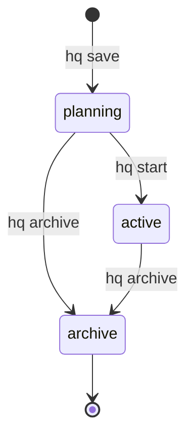
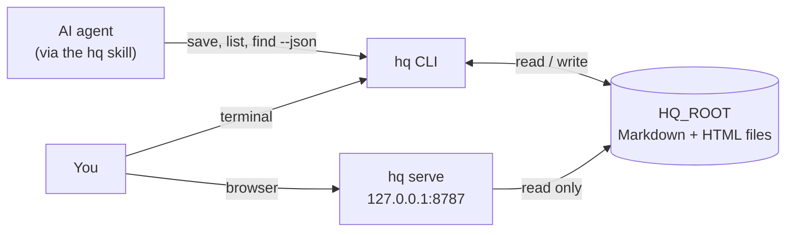
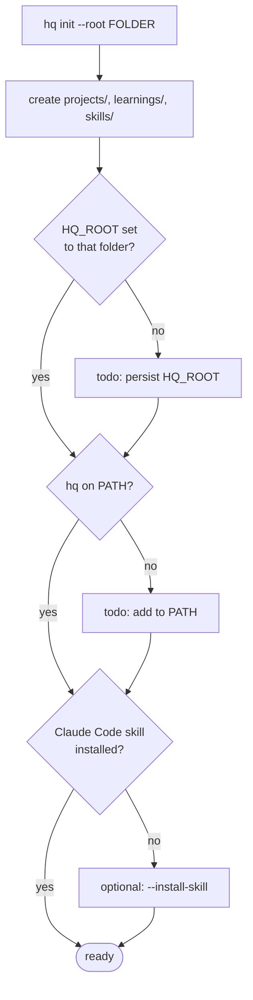
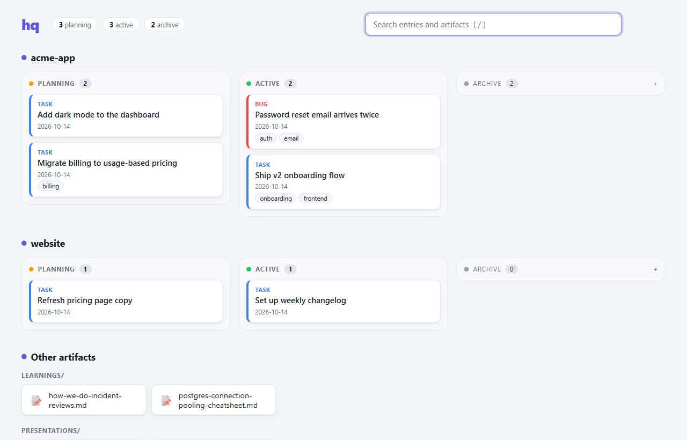
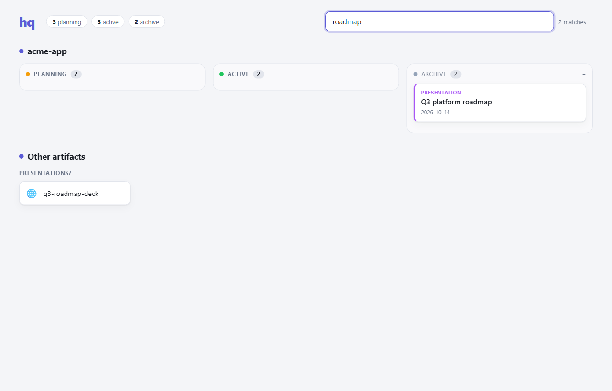
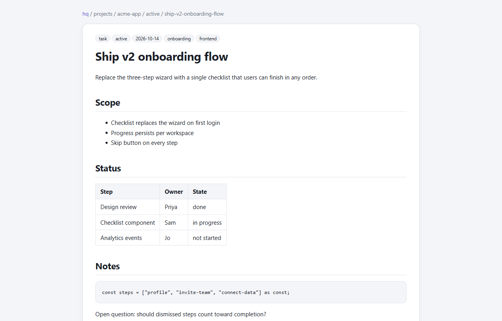
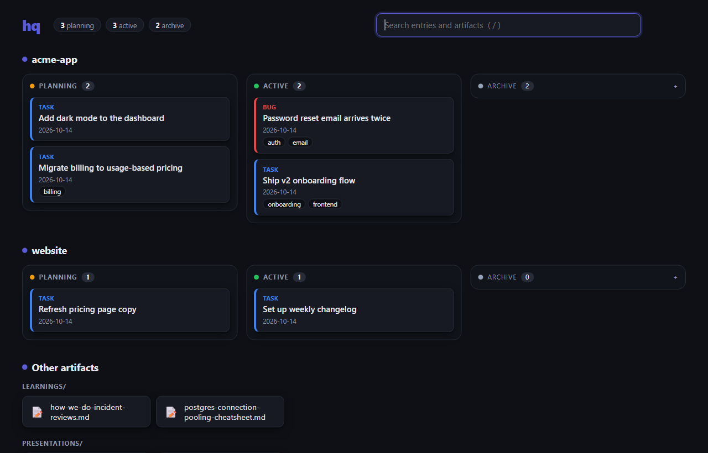
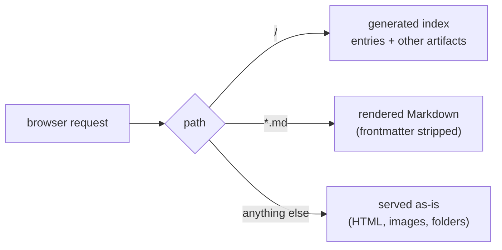

# hq

A plain-Markdown archive for tasks, bugs, presentations, learnings and skills,
with a small CLI to manage it. Agent-first (one line per result, `--json`, real
exit codes, no prompts) but human-browsable (`hq serve`). Stdlib-only Python 3.10+,
no dependencies.

Entries move through a lifecycle:



## How it fits together

Everything lives as plain files in one folder (`HQ_ROOT`). The CLI writes to it,
agents drive the CLI, and `hq serve` is a read-only window onto it for humans.



## Quick start

```
git clone git@github.com:rahidmondal/hq-cli.git
cd hq-cli
python hq.py init --root ~/hq-data
```

`hq init` creates the data folder and then checks the three things that
silently go wrong, printing the exact command to fix each one:

| Check | Why it matters |
|---|---|
| `HQ_ROOT` points at your data folder | If it is unset, hq falls back to `~/.hq` and quietly writes there. |
| `hq` is on `PATH` | So the bare `hq` command works from any directory. |
| Claude Code skill installed | Optional. `hq init --install-skill` copies `hq-skill-template.md` to `~/.claude/skills/hq/SKILL.md`. |



Run the printed `[todo]` commands, open a new terminal, and re-run `hq init` to
confirm everything shows `[ok]`. It is safe to run repeatedly.

Then try it:

```
hq save task "my first task" --project demo
hq list
hq serve          # browse it in your browser
```

The data folder is plain Markdown on disk. Keep it out of this repo; back it up
or sync it however you like.

## Commands

| Command | Flags | Does |
|---|---|---|
| `hq init` | `--root PATH`, `--install-skill` | First-time setup (see above). Defaults to `$HQ_ROOT`. |
| `hq save <kind> "<title>"` | `--project X`, `--tags a,b` | Create an entry in `planning`. `kind` is `task`, `bug`, `presentation`, `learning` or `skill`. Project auto-detects from the current git repo unless `--project` is given; `learning` and `skill` are cross-project and reject `--project`. |
| `hq start <slug>` | `--project X` | Promote a `planning` entry to `active`. |
| `hq archive <slug>` | `--project X` | Move a `planning` or `active` entry to `archive`. |
| `hq list` | `--project X`, `--status planning\|active\|archive`, `--json` | List entries as a table, or one JSON object per line. |
| `hq find <query>` | `--json` | Search titles, tags and body across everything, including learnings and skills. |
| `hq log` | `--project X`, `--since DATE` | Show the append-only action history (`$HQ_ROOT/.log.jsonl`). |
| `hq serve` | `--port N` (8787), `--no-open` | Browse the archive in a browser (see below). |

Every command also has `--help`.

## Advanced mode

hq has two modes. **Classic** is the default and behaves exactly like v1:
same output, same files, same log lines. **Advanced** is a superset that adds
priorities, due dates, goals, areas, blocking, notes and a health check.

```
hq init --mode advanced     # switch on
hq init --mode classic      # switch back
```

The mode lives in `$HQ_ROOT/.hq/config.json`; a missing file means classic.
There is no migration: switching in either direction rewrites nothing. Missing
fields get read-time defaults (priority `P3`; area from goal, then project,
then `work`, or `personal` for a project named `personal`), and classic mode
leaves advanced fields in your files untouched. Advanced-only commands run in
classic mode print `hq: '<cmd>' needs advanced mode` and exit 1.

| Command | Flags | Does |
|---|---|---|
| `hq save <kind> "<title>"` | `--priority P1-P4`, `--goal G`, `--due D`, `--do-on D`, `--est E`, `--area A` | Same as classic, with extra fields. |
| `hq list` | `--area A`, `--goal G`, `--priority P`, `--due-before D` | Adds priority, area and due columns, and filters. Blocked entries show as `blocked`. |
| `hq archive <ref>` | `--dropped` | Archive as `done` (default) or `dropped`; records the outcome. |
| `hq start <ref>`, `hq unstart <ref>` | `--reason TEXT` (unstart) | Promote to `active`, or move an active entry back to `planning`. |
| `hq show <ref>` | `--json` | Show one entry or goal with its fields. |
| `hq set <ref> <field> <value>` | `--project X` | Set a field; the value `none` clears it. |
| `hq note <ref> "<text>"` | `--project X` | Log a note against an entry or goal. |
| `hq block <ref> "<reason>"`, `hq unblock <ref>` | `--project X` | Mark or clear an entry as blocked. |
| `hq goal new "<title>"` | `--area A`, `--target D`, `--priority P`, `--tags a,b` | Create a goal (stored in `goals/`). |
| `hq goal list` | `--status active\|done\|dropped`, `--area A`, `--json` | List goals. |
| `hq goal done <ref>` | `--dropped` | Close a goal. |
| `hq project set <project> area <area>` | | Set a project's default area (stored in `.hq/projects.json`). |
| `hq check` | `--json` | Scan the archive for problems: bad fields, unknown goals, missing artifacts, inbox items older than 14 days, sync-conflict copies. |
| `hq today` | `--area A`, `--json` | What needs you today (see below). |
| `hq free [TIME]` | `--area A`, `--json` | Tasks and reading whose estimate fits in `TIME` (`30m`, `1h`). With no time: until your next event, else 30 minutes. |
| `hq read <url>` | `--priority P`, `--note T`, `--mins N`, `--area A`, `--title T`, `--offline` | Save a link to the reading list. hq fetches the page's title and estimates reading time (~230 words a minute); `--offline` or `"fetch": false` in `.hq/config.json` skips that. |
| `hq read list` / `done <ref>` / `drop <ref>` / `set <ref> <field> <value>` | `--status S`, `--all`, `--json` | The reading list (unread by default). |
| `hq dump "<text>"` | `--area A` | Capture a thought to the inbox. |
| `hq inbox` | `--area A`, `--json` | List the inbox. |
| `hq triage <ref> <to>` | `--project X` and the `save` flags; `--target D` for goals | Turn an inbox item into a task (or any kind), a `goal` or `reading` (its link), or `drop` it. |
| `hq day [DATE]` | `--json`, `--no-git` | What happened that day: actions grouped by area and goal/project, links read, inbox captures, your git commits in recorded repos, events. |
| `hq day end [DATE]` | `--summary "line"`, `--summary-file F` | Save the day to `days/<date>.md` (see below). |
| `hq week [DATE]`, `hq month [DATE]` | `--json`, `--no-git` | The timeline: each day's counts and saved summary, then finished and started work by area and goal/project. |
| `hq cal add "<title>" <start> [<end>]` | `--repeat daily\|weekdays\|weekly`, `--area A`, `--notes T` | Add an event. Start: `2026-10-23 10:00`, `tomorrow 9:30`, `+1d 14:00`, `10:00` (today) or a date (all day). End: a time, a duration (`45m`) or a full time; default 30 minutes. |
| `hq cal list [DATE]` / `rm <ref>` / `export` | `--days N`, `--area A`, `--json` | List upcoming events (7 days), remove one, or write `calendar.ics` for calendar apps (one way). |
| `hq artifact add <ref> <file>` | `--about T`, `--why T`, `--project X` | Copy a file next to an entry or goal (or register one already there) with what it is and why it exists. `hq artifact list <ref>` lists them; `hq show` includes them. |
| `hq init --autostart` / `--no-autostart` | | Start `hq serve` at login and open the Today page (Windows Startup folder, macOS LaunchAgent, Linux XDG autostart). Off by default. |

**Today** builds itself, in this order: today's events; overdue and due
today; planned for today (`do-on`, past ones roll forward); tasks in goals
whose target is within a week; active P1/P2 work; blocked entries with their
reasons; the top three unread links. An entry shows once, in its first
section. Reading items, inbox items and events may have an area; ones
without show under every area filter.

**Day end.** `hq day end` writes `days/<date>.md` with three sections.
*Summary* is a templated recap, or an agent's prose from `--summary-file`;
a rerun refreshes a templated summary but keeps prose. *My notes* is yours:
`--summary "..."` appends a line (never twice) and hq never rewrites it.
*Facts* is regenerated from `hq day` every time. `hq week` and `hq month`
show each day's summary.

**New folders.** Advanced mode adds `reading/`, `inbox/`, `calendar/` and
`days/` at the top of `HQ_ROOT`, one Markdown file per item, and
`.artifacts.json` inside entry folders. Classic mode shows the folders as
plain browsable artifacts and ignores the rest.

`<ref>` is a slug or any unique substring of one; an ambiguous ref is an error
that lists the matches. An exact slug wins over longer ones, except that a bare
name matching a goal and part of an entry's slug is ambiguous: use
`goal/<slug>` for the goal. Edits keep each file's existing line endings, and
setting a field to the value it already has changes nothing and logs nothing.

**Who acted.** The top-level `--by user|agent|web` flag (or the `HQ_ACTOR`
environment variable, default `user`) tags each log line with `"by"`, e.g.
`hq --by agent save task "..."`. Classic mode never writes `by`.

**Formats.**

| Field | Accepts | Example |
|---|---|---|
| priority | `P1`-`P4` (also `p1` or `1`); default `P3` | `--priority p1` |
| dates (`--due`, `--do-on`, `--target`) | `YYYY-MM-DD`, `today`, `tomorrow`, `+Nd`, `+Nw` (local date) | `--due +2w` |
| estimate (`--est`) | `20m`, `1h`, `1h30m`, or bare minutes | `--est 1h30m` |

## Browsing with `hq serve`

`hq serve` starts a local server on `127.0.0.1` and opens it in your browser.



- **A status board.** Each project gets Planning / Active / Archive columns of
  cards, with a colored kind badge (task, bug, presentation, ...), tags and the
  created date. The archive column is collapsed so it doesn't bury live work.
- **Search.** Type to filter every card and artifact at once (press `/` to jump
  to the search box). Matching archived entries open automatically.



- **Other artifacts.** Everything hq doesn't track as an entry shows up as
  tiles: other top-level folders (learnings, presentations, ...), entry folders
  without a `README.md`, and loose files.
- **Readable Markdown.** `.md` files render as a styled page, with the
  frontmatter (kind, status, date, tags) shown as chips and a breadcrumb back
  to the board. marked.js is vendored, so it works offline.



- **Everything else as-is.** HTML explainers, images and folders are served
  unchanged, so a folder with an `index.html` opens as a site.
- **Dark mode** follows your system setting.



The screenshots use made-up demo data.



It only reads your archive and only listens on localhost. Press ctrl-c to stop.
If the port is taken, pass `--port`.

### In advanced mode

In advanced mode `hq serve` opens the v2 app instead (the v1 board is still at
`/classic`):

- **Today** (the default page) builds itself from your data: overdue and due
  today, planned for today (`do-on`), tasks in goals whose target is within a
  week, active P1/P2 work, and blocked entries with their reasons. A bar shows
  the day's estimated time by priority; **I've got N minutes** lists the open
  tasks whose estimate fits.
- **Board** is the v1 board with priority, area, due, estimate and blocked
  shown on each card. Drag a card between columns to start it, move it back to
  planning, or archive it as done (long-press first on a touch screen). **Goals** shows each goal's progress and target date.
- Click any entry or goal to open its details: change priority, area,
  estimate, due, do-on and goal; start, finish, drop, block or unblock it; add
  a note; see its recent activity and its notes.
- Filter by area (All / Work / Personal). Keys: `t` `b` `g` switch pages, `n`
  new task, `/` search, `j` `k` move, `e` open, `Esc` close.

Every change runs the same command you'd type (`hq --by web ...`), so the
checks and the log match the terminal. The page still only listens on
localhost; changes need a per-run token embedded in the page and a same-origin
request, so other websites can't write to it.

## Data layout

```
$HQ_ROOT/
├── projects/
│   └── <project>/
│       ├── planning/<slug>/README.md
│       ├── active/<slug>/README.md
│       └── archive/<slug>/README.md
├── learnings/<slug>.md
├── skills/<slug>/
│   ├── SKILL.md                # Claude-Code-compatible
│   └── README.md
└── .log.jsonl                  # append-only action log
```

Each `README.md` starts with frontmatter (`project`, `kind`, `status`,
`created`, `tags`). Anything else can sit next to it in the entry folder:
notes, audits, an HTML explainer. `hq list` and `hq serve` only index folders
that have a `README.md`.

## Using it from an agent

Install the skill with `hq init --install-skill`, or copy
`hq-skill-template.md` yourself. In advanced mode the same command installs
`hq-skill-advanced.md` instead (and updates an older copy): a request-to-command
table, `--by agent` on every write, and the day-end recipe. Agents should prefer `hq list --json` and
`hq find --json` and read the `path` field from the result.

## Sharing a skill

`hq save skill "<name>"` produces `$HQ_ROOT/skills/<slug>/SKILL.md` with clean
Claude-Code frontmatter (`name`, `description`) and no hq-specific fields. Copy or
symlink that one file into another machine's `~/.claude/skills/<slug>/`.

## Troubleshooting

- **Entries went to the wrong place.** `HQ_ROOT` was unset, so hq used `~/.hq`.
  hq prints a warning on writes when this happens. Run `hq init`.
- **`hq serve` says the folder does not exist.** Run `hq init` first.
- **Browser says connection refused.** The server isn't running (or you closed
  its terminal). Start it again and keep that terminal open.

## Testing

```
python -m unittest discover -s tests -v
```

## License

[MIT](LICENSE). `marked.min.js` is [marked](https://github.com/markedjs/marked)
v15.0.12, vendored under its own MIT license.
